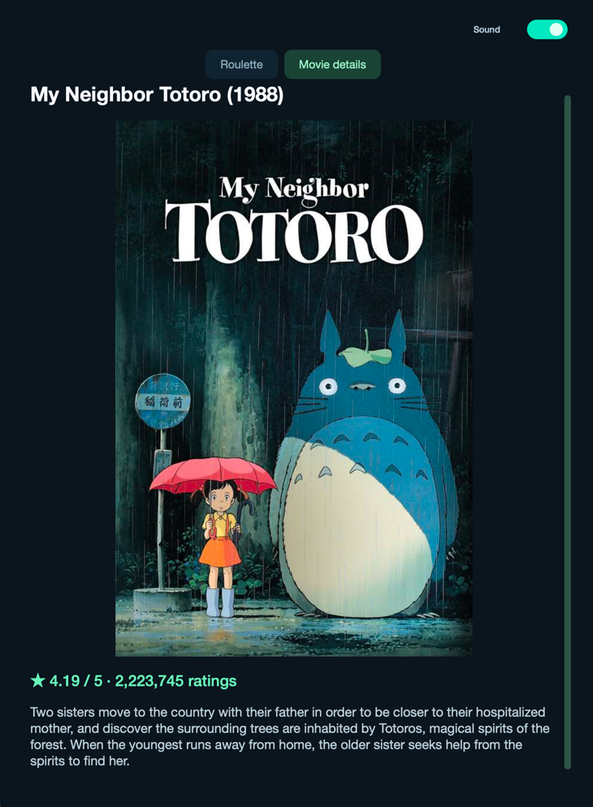

# Movie Roulette for macOS

**500 great films. One spin.**

Find your next watch with an animated roulette wheel featuring [Letterboxd’s Top 500 films](https://letterboxd.com/official/list/letterboxds-top-500-films/), spinning sound, offline support, and in-app movie details.

<table>
<tr>
<th>Roulette</th>
<th>Movie details</th>
</tr>
<tr>
<td align="center" width="50%"></td>
<td align="center" width="50%"></td>
</tr>
</table>

## Run

Requires **macOS 12+** and **Python 3.10–3.14**. From the project folder:

```sh
python3 -m venv .venv
source .venv/bin/activate
python3 -m pip install -r requirements.txt
python3 -m playwright install chromium
python3 app.py
```

For later launches, double-click **Launch Movie Roulette.command**, or run:

```sh
.venv/bin/python app.py
```

## Use

Click **Spin for a film**, then open its Letterboxd page or choose **Find film**. Use the sound toggle in the top-right corner to mute at any time.

Cinejoy opens a unique title/year match, with a search-page fallback. It does not start playback automatically. Live matching still needs verification on a normal Mac session.

The app refreshes Letterboxd’s public list in the background and falls back to a saved cache or bundled snapshot when offline. Each film has a **1-in-500 chance** per spin; repeats are possible.

Open **Movie details** after a spin to fetch the poster, synopsis, and Letterboxd community rating. Details are kept for the current session; an internet connection is required for new film details.

## Tests

```sh
.venv/bin/python -m unittest discover -s tests -v
```

Independent project; not affiliated with Letterboxd or Cinejoy.
