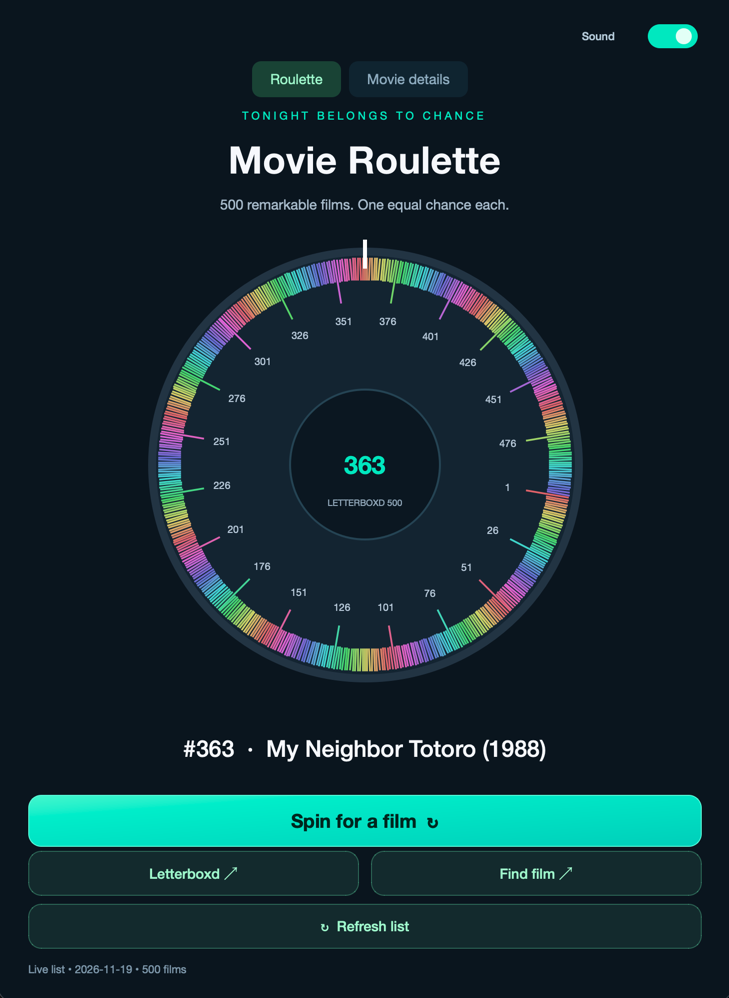

# Movie Roulette

**500 great films. One spin.**

Pick your next watch from [Letterboxd’s Top 500 films](https://letterboxd.com/official/list/letterboxds-top-500-films/) with an animated wheel, spinning sound, offline support, and movie details.

<table>
<tr><th>Roulette</th><th>Movie details</th></tr>
<tr>
<td align="center" width="50%"></td>
<td align="center" width="50%"></td>
</tr>
</table>

## Run

Install **Python 3.10–3.14**, then use your system’s launcher. First-time setup requires internet access.

| System | Launcher |
| --- | --- |
| macOS 12+ | Double-click `Launch Movie Roulette.command` |
| Windows | Double-click `Launch Movie Roulette.bat` |
| Linux | Run `sh "Launch Movie Roulette.sh"` |

Or set up manually from the project folder:

### macOS / Linux

```sh
python3 -m venv .venv
.venv/bin/python -m pip install -r requirements.txt
.venv/bin/python -m playwright install chromium
.venv/bin/python app.py
```

On Linux, use `playwright install --with-deps chromium` if browser system libraries are missing. Python venv and Qt system packages may also be required.

### Windows

```powershell
py -m venv .venv
.venv\Scripts\python.exe -m pip install -r requirements.txt
.venv\Scripts\python.exe -m playwright install chromium
.venv\Scripts\python.exe app.py
```

If `py` is unavailable, use `python` for the first command.

## Use

- **Spin for a film:** every film has an equal chance; repeats are possible.
- **Movie details:** see the poster, synopsis, and Letterboxd rating after a spin.
- **Find film:** open a Cinejoy title/year match or fall back to its search page.
- **Sound:** toggle audio in the top-right corner.

The film list refreshes automatically, with an offline snapshot as fallback. New movie details and Cinejoy searches need internet access. Playback does not start automatically.

Windows and Linux have not been tested on real devices. Linux may need additional desktop/audio libraries.

## Customize

Edit `styles.qss` and restart. Keep all source files and assets together; create a separate `.venv` on each system.

Independent project; not affiliated with Letterboxd or Cinejoy.
